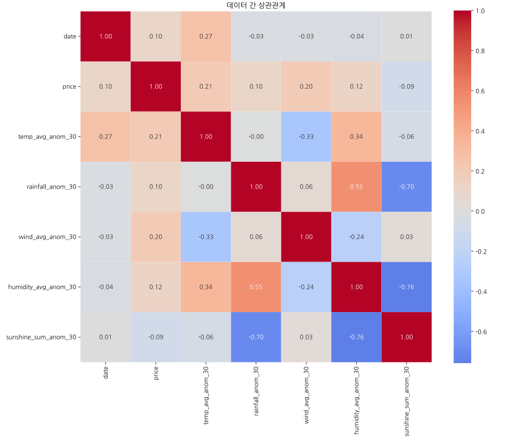
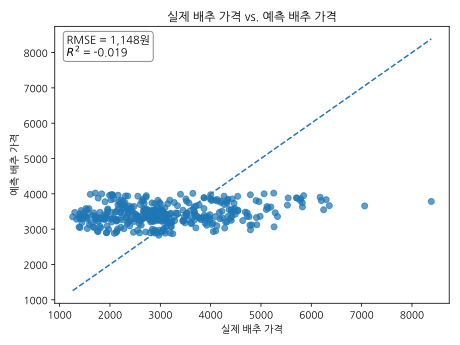
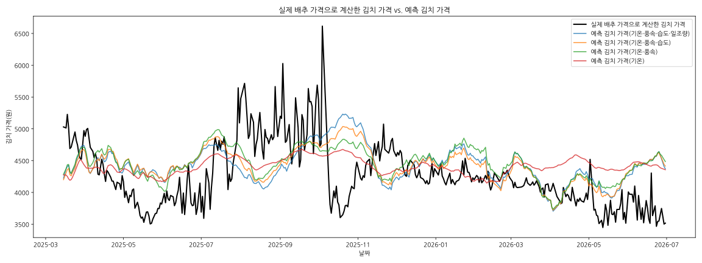
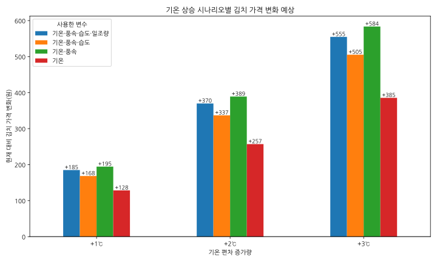

# 기후 변화에 따른 김치 가격 변동 예상

이상기후가 배추 도매가격에 주는 영향을 분석하고, 기온 상승 시나리오에서 김치 가격이 얼마나 달라질지 예상한다.

**저장소**: [github.com/seanoh0218/kimchi_price](https://github.com/seanoh0218/kimchi_price)

## 탐구 질문

1. 이상기후(평년 대비 기상 편차)는 배추 가격과 관련이 있는가?
2. 당일 날씨와 며칠 전 날씨 중 어느 쪽이 가격과 더 관련이 큰가?
3. 기온이 평년보다 1~3 ℃ 높아지면 김치 가격은 얼마나 오르는가?

## 폴더 구조

```
kimchi_price/
├── main.py            # 전체 실행
├── preprocessing.py   # 데이터 정리, 기상 편차·시차 데이터 생성
├── analysis.py        # 산점도·상관 히트맵
├── modeling.py        # 선형회귀 학습·평가
├── figures/           # 결과 그래프
├── data/              # 결과 CSV
└── raw_data/          # 원본 데이터 (저장소에 포함하지 않음)
```

## 실행 방법

```bash
pip install pandas numpy matplotlib seaborn scikit-learn koreanize-matplotlib
python main.py
```

원본 데이터는 아래 출처에서 내려받아 `raw_data/`에 넣는다.

## 데이터

| 데이터 | 출처 | 기간 |
|---|---|---|
| 배추 도매가격 | 공공데이터포털, 한국농수산식품유통공사 「주요 채소류 일일가격 현황」 | 2020. 01.~2026. 06. |
| 기상 관측값 | 기상자료개방포털, 종관기상관측(ASOS) 일자료 | 2020. 01.~2026. 06. |
| 기후 평년값 | 기상자료개방포털, 우리나라 기후평년값 | 1991~2020 |

## 전처리

1. 가격 데이터에서 배추만 남기고 중복, 결측치를 제거한다.
2. 강수량 결측치는 비가 오지 않은 날로 보고 0으로 채운다.
3. 관측소별로 편차(관측값 − 평년값)을 구하고, 날짜별 전국 평균을 낸다.
   - 2월 29일은 2월 28일 평년값을 쓴다.
   - 평년값이 없는 13개 관측소는 제외한다.
4. 가격 날짜를 기준으로 과거 30일 구간의 편차 평균을 구해 시차 데이터를 만든다.

| 파일 | 기상 구간 |
|---|---|
| `data.csv` | 당일 |
| `data_lag_30.csv` | 1~30일 전 |
| `data_lag_60.csv` | 31~60일 전 |
| `data_lag_90.csv` | 61~90일 전 |
※ 기상 구간은 판매일 기준

실제 기온 대신 편차를 쓴 이유는 계절 효과(이를테면 여름에는 당연히 겨울에 비해 기온이 높은 것처럼)를 빼고 평소에 비해 얼마나 이상했는지만 보기 위해서다.

## 분석: 시차별 상관관계

| 기상 편차 | 당일 | 1~30일 전 | 31~60일 전 | 61~90일 전 |
|---|---|---|---|---|
| 기온 | 0.07 | **0.21** | 0.14 | 0.08 |
| 강수량 | 0.05 | 0.10 | 0.10 | 0.09 |
| 풍속 | 0.09 | **0.20** | 0.19 | 0.12 |
| 습도 | 0.06 | 0.12 | 0.10 | 0.11 |
| 일조시간 | -0.04 | -0.09 | -0.03 | -0.01 |

당일 날씨와는 상관이 거의 없고, **1~30일 전 날씨**와의 상관이 가장 높았다. 그래서 이후 분석에는 1~30일 전 데이터를 쓴다.



## 모델: 배추 가격 예측

선형회귀로 배추 가격을 예측했다. 시간에 따른 변화를 나타낸 데이터이므로 날짜순으로 앞 80 %(2020.01~2025.03)를 학습, 뒤 20 %(2025. 03.~2026. 06.)를 평가에 썼다. 강수량은 습도와 상관관계가 강하므로 제외했다.

| 사용한 변수 | R² | RMSE |
|---|---|---|
| 기온·풍속·습도·일조시간 | -0.291 | 1,292원 |
| 기온·풍속·습도 | -0.153 | 1,220원 |
| 기온·풍속 | -0.078 | 1,180원 |
| **기온** | **-0.019** | **1,148원** |

변수를 줄일수록 성능이 나아졌고, 기온만 쓴 모델이 가장 좋았다. 다만 R²가 0에 가까워 평균값을 찍는 것과 비슷한 수준이며, 가격 급등 구간은 따라가지 못했다.



## 김치 가격 환산 asdfasdfasdf

직접 김장할 때의 김치 1kg당 단가를 배추 1포기 가격으로 계산한다.

- 부재료비: 20포기당 130,000원 → 포기당 6,500원
- 완성 김치: 배추 1포기 3kg × 수율 75% = 2.25kg

김치 1kg당 단가 = (배추 1포기 가격 + 6,500) / 2.25

시판 김치(4,500원/kg)와 비교하면 손익분기점은 배추 1포기 3,625원이다. 이보다 싸면 직접 담그는 것이, 비싸면 사 먹는 것이 유리하다.



## 기온 상승 시나리오

평가 기간의 기온 편차만 +1·2·3 ℃ 올려 배추 가격을 예측하고, 김치 가격으로 환산해 평균을 비교했다.

| 시나리오 | 김치 가격 (기온 모델) | 변화 |
|---|---|---|
| 현재 | 4,411원 | - |
| +1 ℃ | 4,539원 | +128원 (+2.9%) |
| +2 ℃ | 4,668원 | +257원 (+5.8%) |
| +3 ℃ | 4,796원 | +385원 (+8.7%) |



## 결론과 한계

**결론**: 이상기후와 배추 가격의 관계는 당일보다 1~30일 전 날씨에서 뚜렷했다. 기온 모델에 따르면 기온이 평년보다 1 ℃ 높아질 때마다 김치 가격은 약 2.9%씩 오른다.

**한계**
- 상관계수가 최대 0.2, R²가 0 근처로 예측력이 매우 낮다. 시나리오 결과는 정확한 예측이 아니라 방향을 보여주는 참고치일 뿐이다.
- 재배 면적, 저장량, 수입, 정책, 김장철 수요 같은 날씨 외 요인을 반영하지 못했다.
- 전국 평균 기상을 써서 실제 산지(여름 강원 고랭지 등)의 날씨가 희석됐을 수 있다.
- 선형 모델이라 폭염·폭우 때의 급등 같은 비선형 관계를 잡지 못한다.
- 김치 가격은 실제 판매가가 아니라 관계식으로 계산한 값이다.
